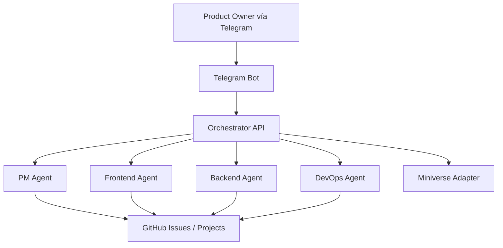

# NitroCircus

Sistema de orquestación multiagente para desarrollo de software, gestionado por un **Project Manager Agent** vía **Telegram**, con ejecución separada por especialidad:

- **PM Agent** — GPT-5.4 Thinking
- **Frontend Agent** — Claude Sonnet 4.6
- **Backend Agent** — Claude Opus 4.6
- **DevOps Agent** — Codex / gpt-5.3-codex

## Objetivo

NitroCircus coordina planificación, ejecución técnica, documentación y entrega de proyectos dentro de un repositorio principal.  
Los proyectos terminados **no se publican automáticamente en producción**: quedan entregados dentro de un directorio interno del repositorio, se versionan también en Git y solo se preparan para despliegue cuando el Product Owner lo ordena.

## Principios operativos

1. **Telegram es la interfaz del Product Owner**
2. **El PM planifica, asigna y reporta**
3. **Los agentes no inician desarrollo sin autorización explícita por Telegram**
4. **GitHub es la fuente de verdad del trabajo**
5. **Los proyectos terminados quedan dentro del monorepo, no en producción**
6. **DevOps prepara despliegue solo bajo demanda**
7. **Miniverse se usa como capa visual, no como cerebro del sistema**
8. **Los bundles de entrega en `projects/` también se versionan**

## Estado inicial del proyecto

Esta documentación define la base de producto, arquitectura, procesos y prompts operativos para iniciar NitroCircus como proyecto en GitHub.

## Estructura recomendada del repositorio

```text
nitrocircus/
├─ README.md
├─ docs/
│  ├─ PROJECT_CHARTER.md
│  ├─ SCOPE.md
│  ├─ ARCHITECTURE.md
│  ├─ STACK_AND_ENVIRONMENTS.md
│  ├─ AGENTS_AND_RESPONSIBILITIES.md
│  ├─ PM_AND_TELEGRAM_WORKFLOW.md
│  ├─ GITHUB_OPERATING_MODEL.md
│  ├─ DELIVERY_AND_DEPLOYMENT_POLICY.md
│  ├─ SECURITY_AND_GOVERNANCE.md
│  ├─ MINIVERSE_INTEGRATION.md
│  ├─ ROADMAP.md
│  ├─ BACKLOG.md
│  ├─ DECISIONS.md
│  └─ prompts/
│     ├─ MASTER_SYSTEM_PROMPT.md
│     ├─ PM_AGENT_PROMPT.md
│     ├─ FRONTEND_AGENT_PROMPT.md
│     ├─ BACKEND_AGENT_PROMPT.md
│     └─ DEVOPS_AGENT_PROMPT.md
└─ projects/
   └─ .gitkeep
```

## Flujo base



## Regla crítica

**Planificado no significa iniciado.**  
El PM puede preparar backlog, tareas y asignaciones, pero el desarrollo solo comienza cuando el Product Owner lo autoriza por Telegram.

## Siguiente paso recomendado

1. Crear el repositorio `nitrocircus`
2. Subir esta documentación base
3. Crear tablero GitHub Project
4. Cargar backlog inicial
5. Definir primer sprint: orquestador + bot Telegram + PM agent + modelo de eventos
