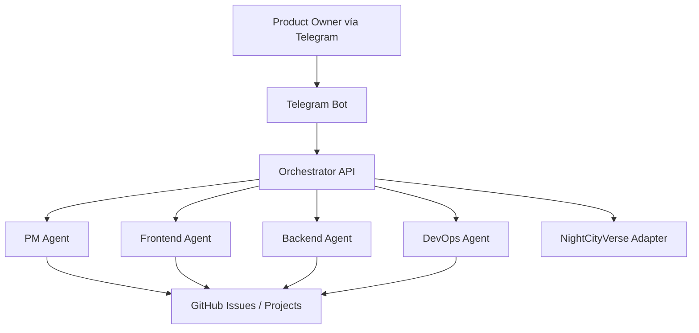

# NitroCircus

Sistema de orquestación multiagente para desarrollo de software, gestionado por un **Project Manager Agent** vía **Telegram**, con ejecución separada por especialidad:

- **PM Agent** — GPT-5.4 Thinking/Grok Ollama
- **Frontend Agent** — Claude Sonnet 4.6
- **Backend Agent** — Claude Opus 4.6
- **DevOps Agent** — Codex / gpt-5.3-codex

## Objetivo del sistema

NitroCircus coordina planificación, ejecución técnica, documentación y entrega de proyectos dentro de un repositorio principal.  
Los proyectos terminados **no se publican automáticamente en producción**: quedan entregados dentro de un directorio interno del repositorio, se versionan también en Git y solo se preparan para despliegue cuando el Product Owner lo ordena.

## Principios operativos

1. **Telegram es la interfaz del Product Owner**
2. **El PM planifica, asigna y reporta**
3. **Los agentes no inician desarrollo sin autorización explícita por Telegram**
4. **GitHub es la fuente de verdad del trabajo**
5. **Los proyectos terminados quedan dentro del monorepo, no en producción**
6. **DevOps prepara despliegue solo bajo demanda**
7. **NightCityVerse se integra como proyecto visual separado, no como cerebro del sistema**
8. **Los bundles de entrega en `projects/` también se versionan**

## Arquitectura actual

```text
nitrocircus/
├─ README.md
├─ apps/
│  ├─ api/                    # Fastify orquestador (fuente de verdad)
│  ├─ bot/                    # Bot Telegram (gateway del Product Owner)
│  └─ web/                    # UI web operativa
├─ workers/
│  └─ agent-runner/           # runner técnico (host, no Docker)
├─ packages/shared/           # tipos y contratos compartidos
├─ docs/                      # arquitectura, decisiones y operación
├─ projects/                  # bundles de entrega versionados
└─ .github/workflows/         # CI/CD y tareas operativas
```

### Runtime real
- **Docker**: `api`, `bot`, `mongo`, `redis`
- **Host**: `agent-runner` via PM2 en checkout aislado `/opt/nitrocircus-runner`
- **Integraciones**: GitHub Issues/Projects + NightCityVerse externo por `NIGHTCITYVERSE_URL`



NightCityVerse vive en repositorio separado: `https://github.com/eruizpy/nightcityverse.git`.

## Flujo operativo base

1. `/new <proyecto>` crea proyecto en `draft`
2. `/plan <proyecto>` genera épicas/tareas e issues GitHub
3. `/start <proyecto>` encola ejecución técnica por agente
4. runner ejecuta, commitea, empuja branch y notifica estado
5. `/deliver <proyecto>` normaliza tareas a `done` y genera bundle en `projects/<slug>/`
6. `/deploy <proyecto>` sigue siendo opcional y posterior a entrega

## Despliegue paso a paso (producción NitroCircus)

### 1) Prerrequisitos
- VPS Linux con Docker, Docker Compose, PM2, `git`
- Repo clonado en `/opt/nitrocircus`
- Archivo `/opt/nitrocircus/.env` con variables requeridas
- GitHub Actions secrets configurados:
- `VPS_HOST`
- `VPS_USER`
- `VPS_SSH_KEY`

### 2) Variables mínimas recomendadas en `.env`
- `MONGO_USER`, `MONGO_PASS`, `MONGO_DB`
- `MONGO_URI`, `REDIS_URL`
- `TELEGRAM_BOT_TOKEN`
- `GROQ_API_KEY` (PM agent)
- `GITHUB_TOKEN`, `GITHUB_OWNER`, `GITHUB_REPO`, `GITHUB_PROJECT_NUMBER`
- `NIGHTCITYVERSE_URL` para conector visual externo

### 3) Disparar deploy
- El deploy corre automático con push a `main` usando `.github/workflows/deploy.yml`
- También puedes lanzarlo manualmente desde Actions si corresponde

### 4) Qué hace el deploy
- actualiza `/opt/nitrocircus` a `origin/main`
- reconstruye stack Docker (`api`, `bot`, `mongo`, `redis`)
- prepara checkout aislado `/opt/nitrocircus-runner`
- reinicia runner PM2 `nitrocircus-agents` apuntando al checkout aislado
- ejecuta health check de API

### 5) Validación post-deploy
- API:
```bash
curl -sS http://<VPS_IP>:3000/health
```
- workflows:
```bash
gh run list -R eruizpy/nitrocircus --limit 5
```
- runner host:
```bash
ssh <host> "pm2 status nitrocircus-agents"
```

### 6) Troubleshooting rápido
- Si falla `Deploy NitroCircus`, revisar primero job `Type check`
- Si runner no mueve estados, revisar `ORCHESTRATOR_URL`, `REPO_PATH` y conectividad Redis
- Si board de GitHub no sincroniza completo, validar scope `project` del token
- Si NightCityVerse no refleja eventos, validar `NIGHTCITYVERSE_URL` y endpoint `/api/heartbeat` del servicio externo

## Seguridad y credenciales

- No commitear `.env` ni secretos reales
- Usar solo `.env.example` con placeholders
- Ejecutar chequeo local:
```bash
npm run security:secrets
```
- CI bloquea patrones obvios de credenciales con:
- `.github/workflows/security-secrets.yml`

Referencias:
- `docs/ARCHITECTURE.md`
- `docs/DELIVERY_AND_DEPLOYMENT_POLICY.md`
- `docs/CREDENTIALS_SECURITY_BASELINE.md`
