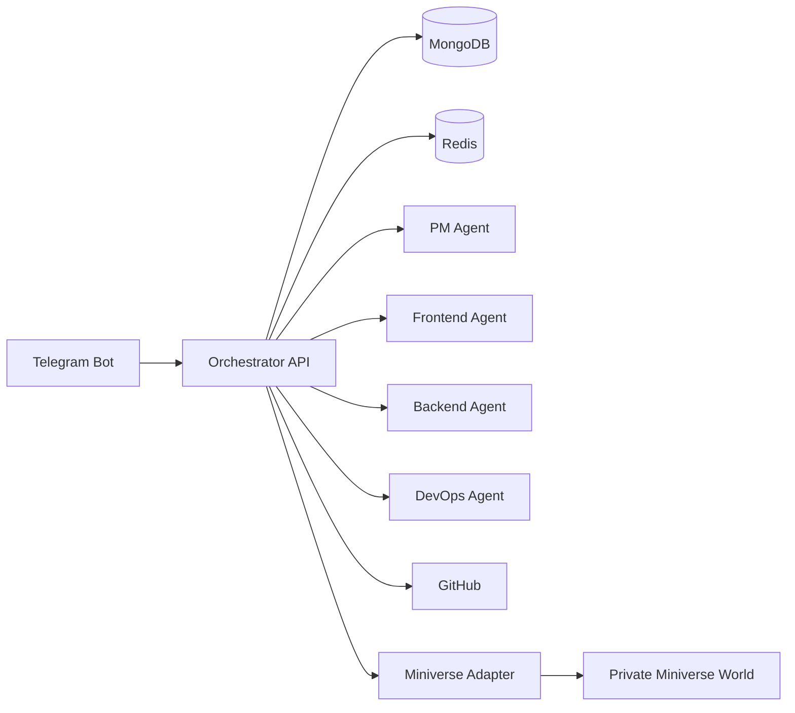

# Architecture

## Resumen

NitroCircus debe separarse en cinco capas:

1. **Canal de entrada**
2. **Orquestación**
3. **Ejecución por agentes**
4. **Persistencia y cola**
5. **Visualización**

## Componentes

### 1. Telegram Bot Gateway
Recibe mensajes del Product Owner, valida comandos y los entrega al orquestador.

### 2. Orchestrator API
Fuente de control del sistema.  
Responsable de:
- registrar iniciativas,
- crear work items,
- mantener estados,
- emitir eventos,
- llamar a los agentes,
- publicar reportes.

### 3. PM Agent
Toma instrucciones del Product Owner y las convierte en:
- épicas,
- historias,
- tareas,
- dependencias,
- riesgos,
- criterios de aceptación,
- asignaciones.

### 4. Frontend Agent
Responsable únicamente de trabajo frontend TypeScript.

### 5. Backend Agent
Responsable únicamente de backend Node.js, Redis, MongoDB y lógica cloud.

### 6. DevOps Agent
Responsable únicamente de:
- CI/CD,
- GitHub Actions,
- empaquetado,
- separación de proyecto,
- preparación de despliegue bajo demanda.

### 7. GitHub Integration
Gestiona:
- issues,
- branches,
- PRs,
- comments,
- GitHub Projects,
- release metadata.

### 8. Redis
Usado para:
- colas,
- locks,
- rate limiting,
- mensajes efímeros,
- coordinación de trabajos.

### 9. MongoDB
Usado para:
- estado de proyectos,
- tareas,
- prompts,
- auditoría,
- metadata de agentes,
- logs estructurados.

### 10. Miniverse Adapter
Sincroniza estados y presencia visual de agentes hacia Miniverse.

## Diagrama

## Principio crítico
El **Orchestrator API** es la fuente de verdad operativa.  
Ni Telegram, ni GitHub, ni Miniverse reemplazan este rol.

## Estilo arquitectónico
- Event-driven orchestration
- Modular monolith en fase 1 o microservicios ligeros según complejidad
- Integraciones externas desacopladas
- Estado persistente y auditable
