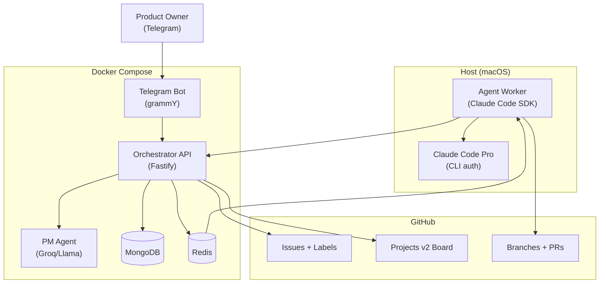

# Architecture

## Resumen

NitroCircus se divide en cinco capas:

1. **Canal de entrada** — Telegram Bot Gateway
2. **Orquestación** — Orchestrator API
3. **Ejecución por agentes** — PM Agent (Groq) + Execution Agents (Claude Code SDK)
4. **Persistencia y cola** — MongoDB + Redis
5. **Visualización** — Miniverse (no crítico)

---

## Componentes

### 1. Telegram Bot Gateway (Docker)
Recibe mensajes del Product Owner, valida que el remitente sea el owner autorizado, y traduce comandos a llamadas al Orchestrator API.

### 2. Orchestrator API (Docker — Fastify)
Fuente de control del sistema. Responsable de:
- registrar proyectos, épicas y tareas,
- mantener la máquina de estados,
- emitir eventos auditables,
- llamar al PM Agent,
- publicar tareas en las colas Redis para los agentes de ejecución,
- exponer endpoints REST para el bot y el worker.

### 3. PM Agent (Docker — Groq/Llama)
Toma instrucciones del Product Owner y genera:
- épicas, historias, tareas,
- criterios de aceptación, dependencias, riesgos, asignaciones.

Usa `llama-3.3-70b-versatile` vía Groq (free tier). No escribe código.

### 4. Agent Worker (host — Claude Code SDK)
Proceso Node.js que corre **en el host** (fuera de Docker), autenticado con Claude Code Pro.

Consume colas Redis:
- `queue:frontend` → Frontend Agent
- `queue:backend` → Backend Agent
- `queue:devops` → DevOps Agent

Cada agente usa `@anthropic-ai/claude-code` SDK con:
- `permissionMode: 'acceptEdits'` — escribe código sin pedir confirmación
- paths permitidos por agente (ver tabla de ownership)
- `maxTurns` limitado para evitar bucles

Al completar: hace commit, empuja branch, notifica a la API (`POST /commands`).

### 5. GitHub Integration
Gestiona:
- Issues (creados por PM Agent durante `/plan`)
- Labels (project, agent, priority, status)
- GitHub Projects v2 board (columnas: Backlog → Ready → In progress → In review → Done)
- Branches (`feat/<project>/<task>`)
- Draft PRs con plan técnico o código real

### 6. Redis
- Colas de tareas para agentes (`queue:frontend`, `queue:backend`, `queue:devops`)
- Locks de concurrencia
- Rate limiting

### 7. MongoDB
- Estado de proyectos, épicas, tareas
- EventLog (audit trail de cada transición)
- AgentRun (registro de ejecuciones)

### 8. Miniverse Adapter (pendiente)
Sincroniza estados hacia Miniverse para visualización social.

---

## Diagrama



---

## Flujo end-to-end

```
PO: /new Landing Page
  → API crea Project (draft)

PO: /plan <id>
  → PM Agent (Groq) genera épicas + tareas
  → API persiste en MongoDB
  → API crea GitHub Issues + los agrega al board (Backlog)
  → Tasks en estado awaiting_start_approval

PO: /start <id>
  → Tasks → in_progress
  → API publica cada task en queue:frontend / queue:backend / queue:devops
  → GitHub Issues → In progress

Agent Worker (host):
  → BRPOP queue:backend → recibe tarea
  → Claude Code SDK escribe código en apps/api/
  → git commit + push branch
  → Notifica API: task → in_review
  → GitHub Issue → In review

PO: /approve <task-id>
  → Task → done
  → GitHub Issue cerrado
```

---

## Principio crítico

El **Orchestrator API** es la única fuente de verdad operativa.
Ni Telegram, ni GitHub, ni el agent worker pueden modificar estado sin pasar por la API.

## Boundary: Docker vs Host

| Componente | Entorno | Motivo |
|---|---|---|
| Telegram Bot | Docker | Stateless, sin credenciales de usuario |
| Orchestrator API | Docker | Stateless, solo necesita MongoDB/Redis |
| PM Agent | Docker | Solo LLM call vía HTTP, sin FS access |
| Agent Worker | Host | Necesita Claude Code Pro auth + acceso al FS del repo |
| MongoDB | Docker | Datos persistidos en volume |
| Redis | Docker | Efímero, colas y locks |
